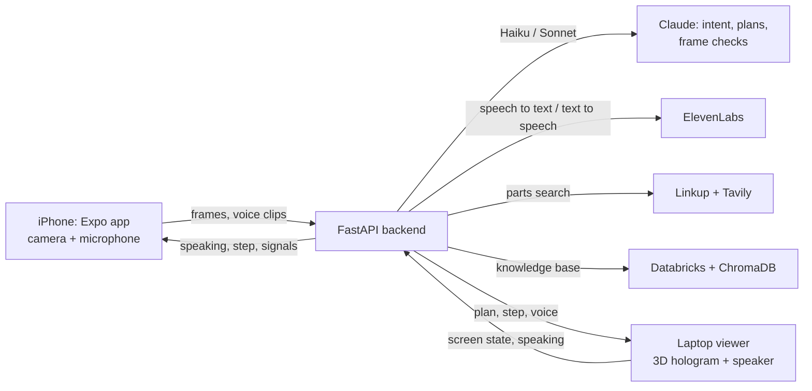

# Spanner

**Point your phone at what's broken, and it talks you through the fix, step by step, hands-free.**

Spanner is a live AI repair assistant built at the Imperial AI Hackathon (14–15 Nov 2026). Your phone is the eyes and ears: it streams the camera and your voice. Your laptop shows a 3D hologram of the device, speaks the instructions and tells you when you've done a step right or wrong.

## What it does

1. **You say what's wrong.** "The fuse in my plug has blown." No menus, and nothing is decided before you speak.
2. **Claude plans the repair** for that exact fault, in short steps the hologram can play and the camera can check.
3. **The hologram shows each step.** It takes the device apart to the part you need and highlights it.
4. **The camera checks your progress.** The guide moves on only when it can see the device and the step is done. It flags a mistake after two agreeing frames, not one lucky one.
5. **It talks to you** (ElevenLabs) and listens (phone microphone). Tap the screen to cut it off and talk over it.
6. **It finds parts** when you ask to order or replace something, searching only for what you asked for.
7. **It stays safe.** Mains work always starts with "unplug it", and scorched, sparking, hot or damaged plugs are refused.

Devices with a guided repair: a mechanical keyboard, iPhone 15, iPad, Sennheiser Momentum 4 headphones, and a modern moulded UK 13 A plug (the fuse-swap demo).

## How it works



- **Fast loop:** each camera frame is cropped, resized and checked against the current step.
- **Slow loop:** planning and conversation run in the background so the hologram never waits on Claude.
- **Models:** Claude Haiku 5.5 for quick decisions, Claude Sonnet 5.5 for planning and spoken turns that include a picture, Claude Opus 5.5 for research and dataset generation.
- **Mock mode:** every stage can return fixture data with no API keys (`USE_MOCKS=1`), so each part can be built and tested on its own.

More detail: [VISION.md](VISION.md), [CONTRACTS.md](CONTRACTS.md), [SUBMISSION.md](SUBMISSION.md), [PITCH.md](PITCH.md), [training/README.md](training/README.md).

## Quick start

You need Python with [uv](https://docs.astral.sh/uv/), Node.js, an iPhone with **Expo Go**, and a laptop with Chrome or Edge on the same network (or a Cloudflare tunnel).

```bash
uv sync                      # once; the vision libraries are large (torch is ~2 GB)
cp .env.example .env         # then fill in your keys (see below)
./start.sh                   # backend + public tunnel + Expo + opens the laptop viewer
```

Or run the pieces yourself:

```bash
uv run uvicorn backend.main:app --host 0.0.0.0 --port 8000      # backend
cd app && npm install && npx expo start --lan                   # phone app (Expo Go)
cloudflared tunnel --url http://localhost:8000                  # only if the network blocks LAN
```

Then:

1. Open `http://<your-laptop-ip>:8000/training/viewer/` in Chrome or Edge.
2. In Expo Go, open the Spanner project and scan the pairing QR code on the viewer.
3. Say what's wrong, for example **"the fuse in my plug has blown"**.

The plug demo page is `/training/viewer/device.html?d=plug13a`. Open `http://localhost:8000/debug` to watch frames, detections and stage timings.

### Keys (`.env`)

| Key | Needed for |
|---|---|
| `ANTHROPIC_API_KEY` | everything that thinks (required unless `USE_MOCKS=1`) |
| `ELEVENLABS_API_KEY`, `ELEVENLABS_VOICE_ID` | Spanner's voice and speech recognition |
| `LINKUP_API_KEY`, `TAVILY_API_KEY` | live part search (`uv sync --group training` installs the clients) |
| `DATABRICKS_*` | knowledge base, learning loop and dashboard (optional; SQLite is the fallback) |

Never commit `.env`. Other switches: `USE_MOCKS`, `PASS1_BACKEND`, `STORE_BACKEND`, `FAL_ENABLED`.

## Tests

```bash
uv run pytest                 # no keys needed; add -m live for real API tests
cd app && npx tsc --noEmit    # type-check the phone app
```

Handy tools:

```bash
uv run python scripts/run_pipeline.py fixtures/frames/placeholder.jpg fixtures/audio/question.mp3
uv run python scripts/live_client.py --url http://127.0.0.1:8000 --frame fixtures/frames/placeholder.jpg   # fake phone
uv run python scripts/gen_types.py      # refresh app/types/contracts.ts from the backend contracts
```

## Repository layout

| Path | What's in it |
|---|---|
| `app/` | Expo / React Native phone app (camera, voice, call screen) |
| `backend/` | FastAPI server: `coach.py` (live coach), `planner.py` and `device_planner.py` (repair plans), `shop.py` (parts), `voice/`, `vision/`, `brain/` (prompts and passes) |
| `training/` | Laptop viewer (`viewer/`: Three.js holograms), knowledge-base and dataset pipeline |
| `databricks/` | Unity Catalog setup, pipeline, dashboard and Genie |
| `data/` | Cached repair plans, parts cards and 3D models |
| `fixtures/` | Mock data for running with no keys |
| `tests/` | Backend test suite |
| `scripts/` | Pipeline runner, fake phone, type generator |

## Tech stack

- **Phone:** Expo SDK 58, React Native 0.88, React 19, TypeScript, `expo-camera`, `expo-audio`.
- **Laptop viewer:** plain JavaScript and Three.js (procedural 3D models built from named parts).
- **Backend:** Python, FastAPI, Uvicorn, Pydantic v2.
- **AI:** Anthropic Claude (Haiku, Sonnet, Opus), ElevenLabs (voice and transcription), YOLO with ByteTrack (detection), Adaption (step-tracker model), Gemini and faster-whisper in the training pipeline.
- **Knowledge and search:** Databricks (Unity Catalog, Vector Search, dashboard), ChromaDB, Linkup, Tavily.

## Safety

Spanner guides simple home repairs only. It will not plan work on anything that is plugged in or live, a swollen, leaking or punctured battery, or a damaged plug or cable, and it tells you to call a professional instead. Always follow the safety steps on screen and use your own judgement.

## Status

Built in a weekend as a hackathon project. The keyboard, phone, tablet, headphones and plug repairs run end to end with real keys.

## Credits

Built at the Imperial AI Hackathon (14–15 Nov 2026) by:

- **Aura Maker**
- **Mikhail Sumygin**
- **Dev**
- **Yash Ghanate**

Thanks to the sponsors and tools that made it possible: [Anthropic](https://www.anthropic.com) (Claude), [ElevenLabs](https://elevenlabs.io), [Databricks](https://www.databricks.com), [Linkup](https://www.linkup.so), [Tavily](https://tavily.com), Adaption, [Figma](https://www.figma.com), [Expo](https://expo.dev), [Three.js](https://threejs.org) and [Ultralytics YOLO](https://www.ultralytics.com). The code was written with [Claude Code](https://claude.com/claude-code).
